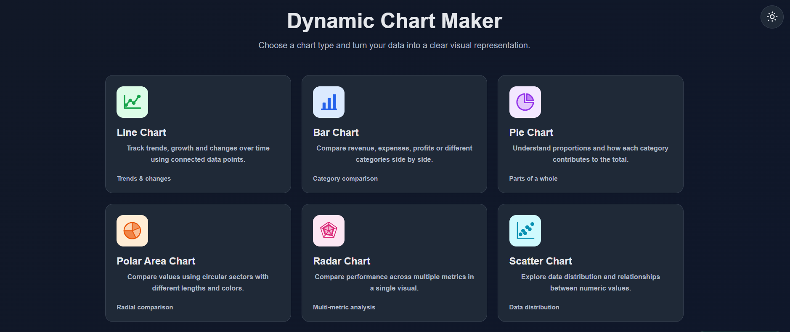

# 📊 Dynamic Chart Maker

Create beautiful, interactive charts from your own data with **Dynamic Chart Maker** — a free, browser-based chart generation tool.

## 🌐 Live Demo

Try it here: https://dynamic-chart-maker.netlify.app/



## ✨ Features

- 📈 Six chart types: Line, Bar, Pie, Polar Area, Radar, and Scatter.
- 🎨 Interactive charts powered by Chart.js.
- 🌙 Dark and light mode with system theme detection.
- 📱 Responsive design for desktop, tablet, and mobile.
- 📝 Custom chart titles and category labels.
- 📊 Multiple datasets for comparing values.
- ✅ Input validation for numeric values and category counts.
- ✏️ Edit chart data and regenerate charts.
- ⚡ Instant chart generation in the browser.
- 🆓 Free to use, with no account required.

## 📊 Available Chart Types

| Chart Type | Best Used For |
|---|---|
| Line Chart | Tracking trends over time |
| Bar Chart | Comparing categories and values |
| Pie Chart | Showing proportions |
| Polar Area Chart | Comparing circular sectors |
| Radar Chart | Comparing multiple metrics |
| Scatter Chart | Exploring numeric data distribution |

## 🛠️ Technologies Used

- HTML5
- CSS3
- JavaScript
- Chart.js

## 🚀 Getting Started

### Prerequisites

- A modern web browser
- An internet connection to load Chart.js from its CDN

### Run Locally

1. Clone this repository:

   ```bash
   git clone YOUR_GITHUB_REPOSITORY_URL
   ```

2. Open the project folder:

   ```bash
   cd dynamic-chart-maker
   ```

3. Open `index.html` in your browser.

No additional installation or build tools are required.

## 📖 How to Use

1. Open the website.
2. Select a chart type.
3. Enter a chart title.
4. Add comma-separated category labels, for example:

   ```text
   Jan, Feb, Mar, Apr
   ```

5. Enter the corresponding numeric values:

   ```text
   50000, 60000, 55000, 70000
   ```

6. Add datasets if needed.
7. Click **Generate Chart**.
8. Use **Edit Data** to update your chart.

**Note:** Every dataset must contain exactly one numeric value per category. Pie chart values must be non-negative, with a total greater than zero.

## 📁 Project Structure

```text
dynamic-chart-maker/
├── index.html
└── README.md
```

## 🔒 Privacy

The core chart generation and data validation run in your browser. No account or backend server is required.

## 🤝 Contributing

Suggestions, bug reports, and contributions are welcome.

1. Fork the repository.
2. Create a branch for your changes.
3. Make your improvements.
4. Submit a pull request.

## 🚀 Future Improvements

- Export charts as PNG or JPEG.
- Export data to CSV.
- Save and load chart configurations.
- Add more chart customization options.

## 📄 License

No license has been specified yet. Add a license if you want to define how others may reuse and distribute this project.

---

**Made with ❤️ using HTML, CSS, JavaScript, and Chart.js.**

If you find this project useful, consider giving it a ⭐ on GitHub!
